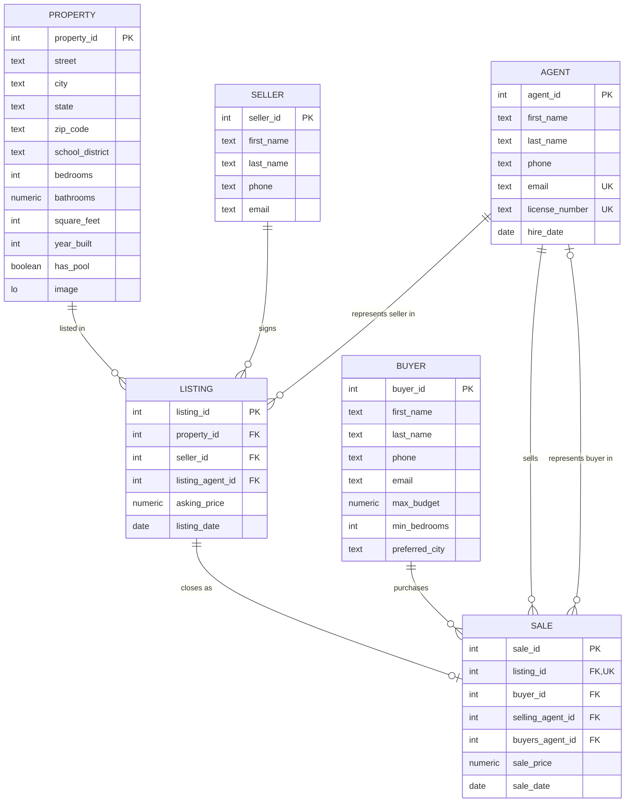

# Real Estate Project

A desktop app for running a real-estate office. Includes agents, buyers, sellers, and homes on the market and recent sales. 

## Setup

Requires [Docker](https://docs.docker.com/get-docker/) and Python 3.12+ with Tkinter. Start the database, then install with either pip or [uv](https://docs.astral.sh/uv/).

```bash
docker compose up -d --wait
```

With pip:

```bash
python3 -m venv .venv
source .venv/bin/activate    
pip install -r requirements.txt
python -m seed
python main.py
```

With uv:

```bash
uv sync
uv run python -m seed
uv run python main.py
```

`python -m seed` replaces everything in the database with sample data. 

## Commands

Run these inside the activated virtual environment, or prefix them with `uv run`.

| Command | Purpose |
| --- | --- |
| `python main.py` | Start the app |
| `python -m seed` | Reset the database to the sample data |
| `python generate_report.py` | Write the schema, table sizes and query answers to `docs/report.md` |
| `pytest` | Run the tests (uses a temporary `realestate_test` database) |
| `ruff check . && ruff format .` | Lint and format |

## Data model



- A property is the physical house. A listing is one agreement to sell it: who the seller is, which agent represents them, the asking price and the date. A listing is available until it has a row in `sales`. Availability is derived by the `property_listings` view, so it can't disagree with the sales records.
- The database enforces the rules: a listing sells at most once, a house can be relisted after it sells but has at most one active listing at a time, and a sale can't predate its listing. The controller translates violations into plain messages.
- Photos are PostgreSQL large objects. They are stored through `lo_from_bytea` and read through `lo_get`, the client-side equivalents of `lo_import` and `lo_export`, because the app and the server don't share a filesystem. The `lo_manage` trigger frees a photo's blob when it is replaced or its home is deleted.

## Architecture

```
main.py       entry point
models/       all dataclasses
repository/   SQL: schema, generic CRUD, report queries
controller/   parsing, validation, errors, entity and report definitions
gui/          Tkinter GUI
seed/         sample data injection
tests/        unit, database and GUI tests
```


